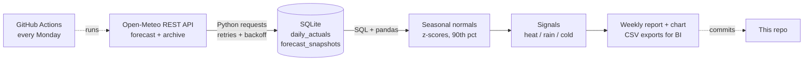

# Weather-Driven Demand Signals: Automated API Pipeline

A scheduled pipeline that pulls weather data for 6 Indian metros from a REST API every week, stores it in SQL,
flags unusual weather in the next 14 days (heat, heavy rain, cold snaps) and publishes a report for demand
planners. It runs without manual steps on **GitHub Actions**.

**Why it matters:** weather shifts demand for seasonal categories (rainwear, summer cottons, winterwear).
Planners usually check forecasts by hand. This pipeline turns the forecast into a weekly, comparable signal:
how far each day sits from the *normal* weather for that city and time of year.

## This week's signals
<!-- REPORT:START -->
**Latest run: 29 Oct 2026, 01:58 IST**. [Full report](reports/weekly_report.md)

| City | Heat days | Heavy rain days | Cold snap days | First flag | Watch-list |
|---|---|---|---|---|---|
| Mumbai | 6 | 0 | 0 | 07 Nov | Summer cottons, linen, sunglasses, sunscreen |
| Delhi | 2 | 0 | 0 | 08 Nov | Summer cottons, linen, sunglasses, sunscreen |
| Bengaluru | 2 | 1 | 0 | 31 Oct | Summer cottons, linen, sunglasses, sunscreen; Rainwear, waterproof footwear, umbrellas |
| Hyderabad | 6 | 0 | 0 | 30 Oct | Summer cottons, linen, sunglasses, sunscreen |
| Chennai | 0 | 0 | 0 | — | No unusual weather |
| Kolkata | 0 | 0 | 0 | — | No unusual weather |


<!-- REPORT:END -->

## How it works


| Step | What happens |
|---|---|
| **Extract** | `requests` session with automatic retries and exponential backoff on 429/5xx errors. One call per city to the forecast API and one to the historical archive API. |
| **Load** | **Incremental**: the first run backfills 5 years of daily history (~11,000 rows). Later runs fetch only new days, plus a 3-day overlap in case values were revised, and **upsert** them into SQLite (`INSERT … ON CONFLICT DO UPDATE`), so re-runs never create duplicates. |
| **Transform** | "Normal" = the same calendar window (±7 days) in previous years. Each forecast day gets a z-score for max/min temperature and is compared with the 90th percentile for rain. |
| **Signal** | Heat: max-temp z ≥ 1.5 or ≥ 40 °C. Heavy rain: ≥ 15 mm and above the 90th percentile. Cold snap: min-temp z ≤ −1.5. |
| **Publish** | Markdown report, chart and CSVs (for Power BI/Tableau/Excel), plus an updated summary at the top of this README. |
| **Monitor** | Each run's forecast is stored, so later runs score **forecast accuracy by lead time** with a SQL join against actuals. Run metadata is logged to `pipeline_runs`. |

## Outputs
- [`reports/weekly_report.md`](reports/weekly_report.md): full report with flagged days, forecast accuracy and data coverage
- [`data/exports/`](data/exports): `forecast_with_normals.csv`, `flagged_days.csv`, `daily_actuals.csv`
- `data/weather.db`: SQLite database (`daily_actuals`, `forecast_snapshots`, `pipeline_runs`)

## Run it locally
```bash
pip install -r requirements.txt
pytest -q                  # offline tests with a mocked API
python -m pipeline.main    # live run against the Open-Meteo API (no key needed)
```

## Project structure
```
pipeline/
  api.py        Open-Meteo client: retries, timeouts, response parsing
  db.py         SQLite schema, upserts and the SQL behind the report
  signals.py    seasonal normals, z-scores, signal rules
  report.py     Markdown report, chart, CSV exports, README update
  main.py       orchestration (incremental load -> signals -> outputs)
tests/          end-to-end and unit tests (mocked API, no network)
.github/workflows/weekly-refresh.yml   schedule, tests, auto-commit
```

## Limitations and next steps
- The category watch-list is an illustrative mapping. The next step is to join signals to actual sales and measure the real uplift per category and city.
- Add more cities and variables (humidity, AQI) and send alerts to Slack or email when a signal fires.

Weather data: [Open-Meteo](https://open-meteo.com/) (free, no API key, CC BY 4.0).
