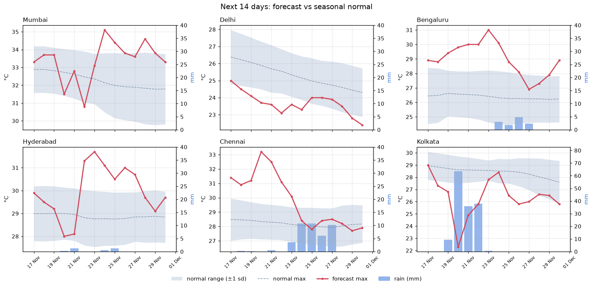

# Weekly weather demand signals
_Generated automatically on 16 Nov 2026, 15:23 IST by GitHub Actions. Data: [Open-Meteo](https://open-meteo.com/)._

## Summary: next 14 days
| City | Heat days | Heavy rain days | Cold snap days | First flag | Watch-list |
|---|---|---|---|---|---|
| Mumbai | 1 | 0 | 0 | 24 Nov | Summer cottons, linen, sunglasses, sunscreen |
| Delhi | 0 | 0 | 0 | — | No unusual weather |
| Bengaluru | 7 | 0 | 2 | 19 Nov | Summer cottons, linen, sunglasses, sunscreen; Jackets, sweatshirts, thermals |
| Hyderabad | 6 | 0 | 0 | 22 Nov | Summer cottons, linen, sunglasses, sunscreen |
| Chennai | 7 | 0 | 2 | 17 Nov | Summer cottons, linen, sunglasses, sunscreen; Jackets, sweatshirts, thermals |
| Kolkata | 0 | 3 | 0 | 20 Nov | Rainwear, waterproof footwear, umbrellas |

Watch-list categories are an illustrative mapping for demand planners. Validate against sales data before acting.

## Flagged days
| Date | City | Signal | Forecast | Normal | z-score | Unit |
|---|---|---|---|---|---|---|
| Tue 17 Nov | Chennai | Heat | 31.4 | 28.5 | 2.0 | °C max |
| Wed 18 Nov | Chennai | Heat | 30.9 | 28.5 | 1.8 | °C max |
| Thu 19 Nov | Bengaluru | Heat | 29.4 | 26.6 | 1.8 | °C max |
| Thu 19 Nov | Chennai | Heat | 31.2 | 28.4 | 2.2 | °C max |
| Fri 20 Nov | Bengaluru | Heat | 29.8 | 26.6 | 2.0 | °C max |
| Fri 20 Nov | Chennai | Heat | 33.2 | 28.3 | 3.9 | °C max |
| Fri 20 Nov | Kolkata | Heavy rain | 63.6 | 0.0 | — | mm (normal = 90th pct) |
| Sat 21 Nov | Bengaluru | Heat | 30.0 | 26.5 | 2.2 | °C max |
| Sat 21 Nov | Chennai | Heat | 32.5 | 28.3 | 3.5 | °C max |
| Sat 21 Nov | Kolkata | Heavy rain | 36.0 | 0.0 | — | mm (normal = 90th pct) |
| Sun 22 Nov | Bengaluru | Heat | 30.0 | 26.5 | 2.1 | °C max |
| Sun 22 Nov | Chennai | Heat | 31.1 | 28.2 | 2.4 | °C max |
| Sun 22 Nov | Hyderabad | Heat | 31.3 | 28.8 | 2.0 | °C max |
| Sun 22 Nov | Kolkata | Heavy rain | 37.8 | 0.0 | — | mm (normal = 90th pct) |
| Mon 23 Nov | Bengaluru | Heat | 31.0 | 26.4 | 2.6 | °C max |
| Mon 23 Nov | Chennai | Heat | 30.1 | 28.1 | 1.6 | °C max |
| Mon 23 Nov | Hyderabad | Heat | 31.7 | 28.8 | 2.4 | °C max |
| Tue 24 Nov | Bengaluru | Heat | 30.1 | 26.3 | 2.1 | °C max |
| Tue 24 Nov | Hyderabad | Heat | 31.1 | 28.8 | 2.0 | °C max |
| Tue 24 Nov | Mumbai | Heat | 35.1 | 32.1 | 1.8 | °C max |
| Wed 25 Nov | Hyderabad | Heat | 30.5 | 28.8 | 1.5 | °C max |
| Thu 26 Nov | Hyderabad | Heat | 31.0 | 28.8 | 1.9 | °C max |
| Fri 27 Nov | Hyderabad | Heat | 30.7 | 28.8 | 1.7 | °C max |
| Sun 29 Nov | Bengaluru | Cold snap | 16.6 | 18.4 | -1.6 | °C min |
| Sun 29 Nov | Chennai | Cold snap | 21.5 | 23.7 | -2.6 | °C min |
| Mon 30 Nov | Bengaluru | Cold snap | 16.4 | 18.3 | -1.8 | °C min |
| Mon 30 Nov | Bengaluru | Heat | 28.9 | 26.2 | 1.7 | °C max |
| Mon 30 Nov | Chennai | Cold snap | 21.3 | 23.7 | -3.0 | °C min |

## Forecast accuracy check
Past forecasts stored by this pipeline, compared with the actual weather (MAE = mean absolute error).

| lead_time | n_forecasts | mae_tmax_c | bias_tmax_c | mae_precip_mm |
|---|---|---|---|---|
| 1-3 days | 48 | 0.81 | -0.12 | 2.20 |
| 4-7 days | 48 | 1.21 | -0.30 | 2.46 |
| 8-14 days | 48 | 1.33 | -0.43 | 1.42 |

## Data coverage
| city | days_stored | first_date | last_date |
|---|---|---|---|
| Bengaluru | 1840 | 2021-10-29 | 2026-11-11 |
| Chennai | 1840 | 2021-10-29 | 2026-11-11 |
| Delhi | 1840 | 2021-10-29 | 2026-11-11 |
| Hyderabad | 1840 | 2021-10-29 | 2026-11-11 |
| Kolkata | 1840 | 2021-10-29 | 2026-11-11 |
| Mumbai | 1840 | 2021-10-29 | 2026-11-11 |
