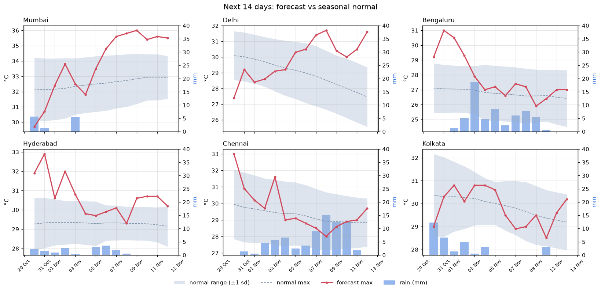

# Weekly weather demand signals
_Generated automatically on 29 Oct 2026, 02:08 IST by GitHub Actions. Data: [Open-Meteo](https://open-meteo.com/)._

## Summary: next 14 days
| City | Heat days | Heavy rain days | Cold snap days | First flag | Watch-list |
|---|---|---|---|---|---|
| Mumbai | 6 | 0 | 0 | 07 Nov | Summer cottons, linen, sunglasses, sunscreen |
| Delhi | 2 | 0 | 0 | 08 Nov | Summer cottons, linen, sunglasses, sunscreen |
| Bengaluru | 2 | 1 | 0 | 31 Oct | Summer cottons, linen, sunglasses, sunscreen; Rainwear, waterproof footwear, umbrellas |
| Hyderabad | 6 | 0 | 0 | 30 Oct | Summer cottons, linen, sunglasses, sunscreen |
| Chennai | 0 | 0 | 0 | — | No unusual weather |
| Kolkata | 0 | 0 | 0 | — | No unusual weather |

Watch-list categories are an illustrative mapping for demand planners. Validate against sales data before acting.

## Flagged days
| Date | City | Signal | Forecast | Normal | z-score | Unit |
|---|---|---|---|---|---|---|
| Fri 30 Oct | Hyderabad | Heat | 31.9 | 29.3 | 1.9 | °C max |
| Sat 31 Oct | Bengaluru | Heat | 31.0 | 27.1 | 2.4 | °C max |
| Sat 31 Oct | Hyderabad | Heat | 32.9 | 29.3 | 2.8 | °C max |
| Sun 01 Nov | Bengaluru | Heat | 30.5 | 27.0 | 2.2 | °C max |
| Mon 02 Nov | Hyderabad | Heat | 32.0 | 29.3 | 2.4 | °C max |
| Tue 03 Nov | Bengaluru | Heavy rain | 18.6 | 8.1 | — | mm (normal = 90th pct) |
| Sat 07 Nov | Mumbai | Heat | 35.6 | 32.6 | 1.7 | °C max |
| Sun 08 Nov | Delhi | Heat | 31.7 | 28.5 | 1.7 | °C max |
| Sun 08 Nov | Mumbai | Heat | 35.8 | 32.7 | 1.8 | °C max |
| Mon 09 Nov | Hyderabad | Heat | 30.6 | 29.3 | 1.5 | °C max |
| Mon 09 Nov | Mumbai | Heat | 36.0 | 32.8 | 1.9 | °C max |
| Tue 10 Nov | Hyderabad | Heat | 30.7 | 29.3 | 1.6 | °C max |
| Tue 10 Nov | Mumbai | Heat | 35.4 | 32.9 | 1.6 | °C max |
| Wed 11 Nov | Hyderabad | Heat | 30.7 | 29.2 | 1.6 | °C max |
| Wed 11 Nov | Mumbai | Heat | 35.6 | 32.9 | 1.8 | °C max |
| Thu 12 Nov | Delhi | Heat | 31.6 | 27.5 | 2.2 | °C max |
| Thu 12 Nov | Mumbai | Heat | 35.5 | 32.9 | 1.8 | °C max |

## Forecast accuracy check
Past forecasts stored by this pipeline, compared with the actual weather (MAE = mean absolute error).

_Builds up automatically: needs a few weekly runs before past forecasts can be compared with actuals._

## Data coverage
| city | days_stored | first_date | last_date |
|---|---|---|---|
| Bengaluru | 1822 | 2021-10-29 | 2026-10-24 |
| Chennai | 1822 | 2021-10-29 | 2026-10-24 |
| Delhi | 1822 | 2021-10-29 | 2026-10-24 |
| Hyderabad | 1822 | 2021-10-29 | 2026-10-24 |
| Kolkata | 1822 | 2021-10-29 | 2026-10-24 |
| Mumbai | 1822 | 2021-10-29 | 2026-10-24 |
