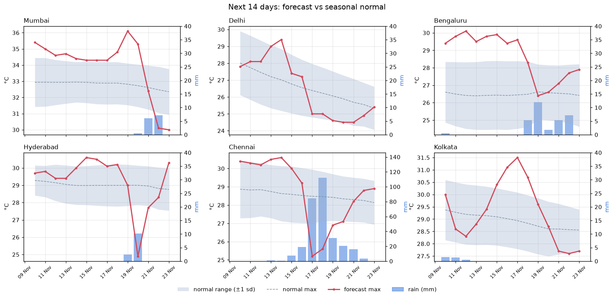

# Weekly weather demand signals
_Generated automatically on 09 Nov 2026, 15:25 IST by GitHub Actions. Data: [Open-Meteo](https://open-meteo.com/)._

## Summary: next 14 days
| City | Heat days | Heavy rain days | Cold snap days | First flag | Watch-list |
|---|---|---|---|---|---|
| Mumbai | 3 | 0 | 0 | 10 Nov | Summer cottons, linen, sunglasses, sunscreen |
| Delhi | 0 | 0 | 0 | — | No unusual weather |
| Bengaluru | 8 | 0 | 0 | 10 Nov | Summer cottons, linen, sunglasses, sunscreen |
| Hyderabad | 0 | 0 | 0 | — | No unusual weather |
| Chennai | 0 | 2 | 0 | 17 Nov | Rainwear, waterproof footwear, umbrellas |
| Kolkata | 3 | 0 | 0 | 16 Nov | Summer cottons, linen, sunglasses, sunscreen |

Watch-list categories are an illustrative mapping for demand planners. Validate against sales data before acting.

## Flagged days
| Date | City | Signal | Forecast | Normal | z-score | Unit |
|---|---|---|---|---|---|---|
| Tue 10 Nov | Bengaluru | Heat | 29.4 | 26.6 | 1.6 | °C max |
| Tue 10 Nov | Mumbai | Heat | 35.4 | 32.9 | 1.6 | °C max |
| Wed 11 Nov | Bengaluru | Heat | 29.8 | 26.5 | 1.8 | °C max |
| Thu 12 Nov | Bengaluru | Heat | 30.1 | 26.4 | 1.9 | °C max |
| Fri 13 Nov | Bengaluru | Heat | 29.5 | 26.4 | 1.6 | °C max |
| Sat 14 Nov | Bengaluru | Heat | 29.8 | 26.4 | 1.7 | °C max |
| Sun 15 Nov | Bengaluru | Heat | 29.9 | 26.4 | 1.8 | °C max |
| Mon 16 Nov | Bengaluru | Heat | 29.4 | 26.4 | 1.5 | °C max |
| Mon 16 Nov | Kolkata | Heat | 31.1 | 29.0 | 1.8 | °C max |
| Tue 17 Nov | Bengaluru | Heat | 29.6 | 26.4 | 1.6 | °C max |
| Tue 17 Nov | Chennai | Heavy rain | 84.6 | 34.5 | — | mm (normal = 90th pct) |
| Tue 17 Nov | Kolkata | Heat | 31.5 | 28.9 | 2.2 | °C max |
| Wed 18 Nov | Chennai | Heavy rain | 112.2 | 33.8 | — | mm (normal = 90th pct) |
| Wed 18 Nov | Kolkata | Heat | 30.7 | 28.8 | 1.6 | °C max |
| Thu 19 Nov | Mumbai | Heat | 36.1 | 32.8 | 2.5 | °C max |
| Fri 20 Nov | Mumbai | Heat | 35.3 | 32.7 | 2.0 | °C max |

## Forecast accuracy check
Past forecasts stored by this pipeline, compared with the actual weather (MAE = mean absolute error).

| lead_time | n_forecasts | mae_tmax_c | bias_tmax_c | mae_precip_mm |
|---|---|---|---|---|
| 1-3 days | 30 | 0.98 | 0.02 | 3.23 |
| 4-7 days | 18 | 1.68 | 0.29 | 4.38 |

## Data coverage
| city | days_stored | first_date | last_date |
|---|---|---|---|
| Bengaluru | 1833 | 2021-10-29 | 2026-11-04 |
| Chennai | 1833 | 2021-10-29 | 2026-11-04 |
| Delhi | 1833 | 2021-10-29 | 2026-11-04 |
| Hyderabad | 1833 | 2021-10-29 | 2026-11-04 |
| Kolkata | 1833 | 2021-10-29 | 2026-11-04 |
| Mumbai | 1833 | 2021-10-29 | 2026-11-04 |
